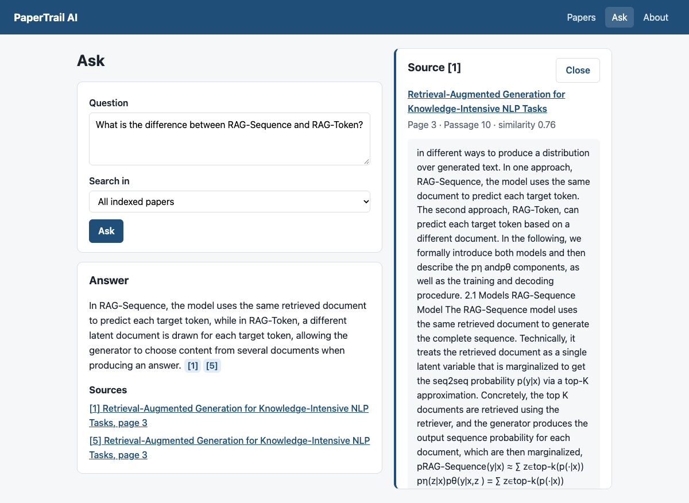
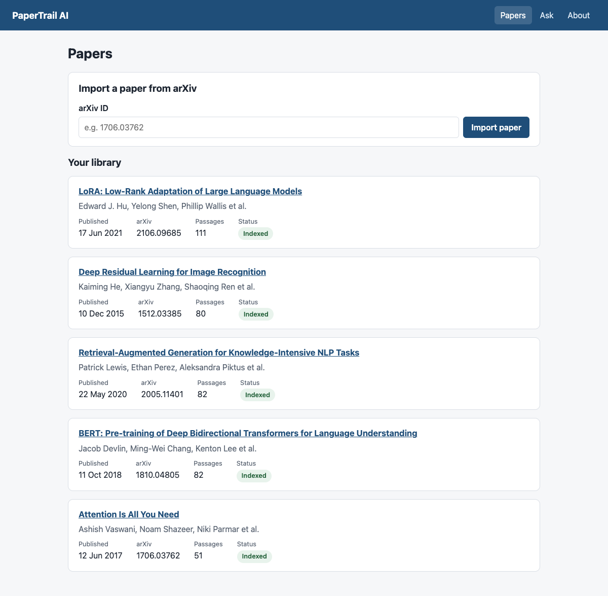
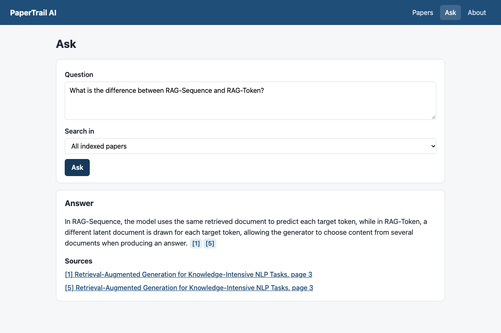
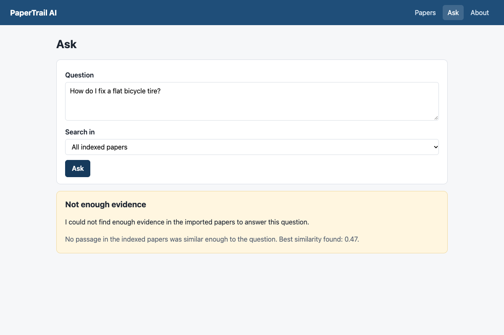

# PaperTrail AI

PaperTrail AI is a local research assistant that combines a scientific-paper ingestion pipeline with
semantic retrieval and retrieval-augmented generation. Papers are imported from arXiv, processed into
searchable passages, embedded locally, stored in PostgreSQL with pgvector, and queried through a React
interface with cited answers.

It is a compact full-stack portfolio project: small enough to understand end to end, with the engineering
practices of a larger one (migrations, idempotent ingestion, typed code, automated tests). Everything runs
on one machine and uses no paid service.



## Features

**Data engineering**
- arXiv ingestion with ID normalization, metadata validation and normalization
- Idempotent imports: importing the same paper twice creates no duplicates
- PostgreSQL relational model (papers, authors, passages) with Alembic migrations
- PDF text extraction and deterministic, overlapping chunking
- Ingestion audit records, including failed attempts and the reason

**AI engineering**
- Local text embeddings (`bge-small-en-v1.5`, 384 dimensions), no API key needed
- pgvector cosine-similarity search and semantic retrieval
- Retrieval-augmented generation with a local LLM through Ollama
- Citations that point to the exact stored passages
- Simple abstention when the papers do not contain enough evidence

**Application**
- FastAPI backend with typed requests and readable error messages
- React + TypeScript interface: Papers, Ask, and About/system information pages
- Responsive layout, loading and error states, keyboard-accessible citation panel

## Architecture

```text
arXiv
  ↓
ingestion
  ↓
PostgreSQL
  ↓
PDF extraction
  ↓
chunking
  ↓
embeddings
  ↓
pgvector
  ↓
semantic search
  ↓
RAG
  ↓
local LLM
  ↓
cited answer
  ↓
FastAPI
  ↓
React
```

**Why PostgreSQL + pgvector instead of a separate vector database?** The corpus is small (hundreds to
a few thousand passages), so one database is simpler to run, back up and reason about. A vector lives in
the same row as the passage text, page and paper, so a search result is directly citable and there is no
second system to keep in sync. A dedicated vector database would be justified at a scale this project does
not target. See [docs/ARCHITECTURE.md](docs/ARCHITECTURE.md) for the data model, the request flows and the
module layout.

## Technology stack

| Technology | Role in this project |
|---|---|
| **Python 3.13** | Backend language (code requires 3.12+) |
| **FastAPI** | HTTP API with request validation and automatic docs at `/docs` |
| **PostgreSQL 17** | The only database: papers, authors, passages, ingestion runs |
| **pgvector** | Vector column and cosine-distance search inside PostgreSQL |
| **SQLAlchemy 2** | ORM for the data model |
| **Alembic** | Versioned, reversible schema migrations |
| **pypdf** | Text extraction from PDFs (no OCR) |
| **bge-small-en-v1.5** | Embedding model: small, MIT-licensed, 384-dimensional vectors |
| **ONNX Runtime** | Runs the embedding model on the CPU without PyTorch |
| **Ollama** | Local server that runs the language model |
| **qwen2.5:7b** | Language model that writes answers from the retrieved passages |
| **React 19 + TypeScript** | User interface |
| **Vite** | Dev server and build tool; proxies `/api` to the backend |
| **pytest** | Backend tests, using fake embedder and LLM implementations |
| **Vitest + Testing Library** | Frontend component and page tests |
| **Playwright** | A few end-to-end tests against the real stack |
| **Docker Compose** | Starts PostgreSQL with pgvector |

## Application workflow

```text
Import paper
→ process PDF
→ create passages
→ generate embeddings
→ index passages
→ ask question
→ retrieve evidence
→ generate grounded answer
→ inspect citations
```

1. **Import**: enter an arXiv ID such as `1706.03762`. Metadata and authors are validated and stored.
2. **Process & index**: the PDF is downloaded, its text extracted and split into overlapping passages, and
   each passage gets an embedding. The Papers page shows each paper's status: *Imported*, *Processed*,
   *Indexed* or *Failed*.
3. **Ask**: the question is embedded, the closest passages are retrieved, and passages above a similarity
   threshold are given to the language model, which must answer only from them and cite them as `[1]`, `[2]`.
4. **Inspect**: click a citation to read the exact stored passage, with its paper, page and similarity score.
5. **Abstain**: if nothing similar enough is found, or the model finds the evidence insufficient, the app
   says so instead of guessing.

## Screenshots

**Papers page**: import a paper, see each paper's status and passage count.



**Ask page**: an answer whose `[1]` and `[5]` markers are clickable.



**Citation panel**: the exact stored passage behind `[1]` (shown at the top of this README).

**Abstention**: an unrelated question gets an explicit "not enough evidence" result.



## Running locally

### Requirements

- **Docker** (Docker Desktop or Docker Engine with Compose) for PostgreSQL
- **Python 3.12+** (developed and tested with 3.13)
- **Node.js 20+** and npm (developed and tested with Node 24)
- **Ollama** for generated answers (optional: import, processing and search work without it)

This repository does **not** install Ollama or download any model for you; the steps below show how.
Roughly 5 GB of disk space is needed for the models.

### 1. Configuration and database

```bash
cp .env.example .env
docker compose up -d          # PostgreSQL 17 + pgvector on localhost:5433
```

### 2. Embedding model (one time, about 64 MB, MIT license)

The embedding model files are not stored in git. Download them from the
[`Qdrant/bge-small-en-v1.5-onnx-Q`](https://huggingface.co/Qdrant/bge-small-en-v1.5-onnx-Q) repository
(an ONNX export of BAAI/bge-small-en-v1.5) into `models/bge-small-en-v1.5/`:

```bash
mkdir -p models/bge-small-en-v1.5
curl -L -o models/bge-small-en-v1.5/model_optimized.onnx \
  https://huggingface.co/Qdrant/bge-small-en-v1.5-onnx-Q/resolve/main/model_optimized.onnx
curl -L -o models/bge-small-en-v1.5/tokenizer.json \
  https://huggingface.co/Qdrant/bge-small-en-v1.5-onnx-Q/resolve/main/tokenizer.json
```

The SHA-256 published by Hugging Face for `model_optimized.onnx` is
`51f1bd0addd6e859e42c2c8021a5e5461385bb676a649f4b269aa445449f2431` (check with `shasum -a 256`).
Use `EMBEDDING_MODEL_DIR` in `.env` to keep the files elsewhere. Without them, `index`, `/search` and `/ask`
return a 503 that says the model is missing.

### 3. Language model with Ollama (one time, about 4.7 GB, Apache-2.0)

Install Ollama from <https://ollama.com/download>, start it, then download the model:

```bash
ollama pull qwen2.5:7b
```

and set `LLM_PROVIDER=ollama` in `.env`. The default is `none`: `/ask` then still retrieves and abstains
when appropriate, but returns a 503 when it would need to generate an answer. The configured model must be
available in Ollama (`ollama list`), otherwise `/ask` returns a 503 saying so.

### 4. Backend

```bash
cd backend
python3 -m venv .venv
.venv/bin/pip install -e ".[dev]"
.venv/bin/alembic upgrade head                       # create the database tables
.venv/bin/uvicorn app.main:app --reload --port 8001  # API on http://localhost:8001, docs at /docs
```

### 5. Frontend

In a second terminal. Any Node 20+ works; if you use conda, an isolated environment is convenient:

```bash
conda create -n papertrail-node -c conda-forge nodejs=24    # optional
conda activate papertrail-node                              # optional

cd frontend
npm ci                  # installs exactly the versions in package-lock.json (or: npm install)
npm run dev             # http://localhost:5173
```

The dev server proxies `/api/*` to `http://localhost:8001` (set `API_URL` to change it), so no CORS
configuration is needed. Open <http://localhost:5173>, import `1706.03762`, click **Process & index**, then
use the **Ask** page. To stop PostgreSQL: `docker compose down` (add `-v` to delete its data).

### Configuration

Settings are environment variables read from `.env` in the repository root. Defaults are in
[`.env.example`](.env.example) and [`backend/app/core/config.py`](backend/app/core/config.py).

| Variable | Default | Meaning |
|---|---|---|
| `POSTGRES_*` | `papertrail` / `localhost:5433` | Database connection (also used by `docker-compose.yml`) |
| `LLM_PROVIDER` | `none` | `none` or `ollama` |
| `OLLAMA_URL`, `OLLAMA_MODEL` | `http://localhost:11434`, `qwen2.5:7b` | Local model server |
| `RAG_MIN_SCORE` | `0.70` | Minimum cosine similarity for a passage to count as evidence |
| `CHUNK_SIZE_WORDS`, `CHUNK_OVERLAP_WORDS` | `150`, `30` | Chunking (overlap must be smaller than size) |
| `EMBEDDING_MODEL_DIR` | `models/bge-small-en-v1.5` | Where the embedding model files are |
| `LOG_LEVEL` | `INFO` | Backend log level |

## Testing

Each check lists what it needs. "PostgreSQL" means `docker compose up -d`.

| Check | Command | Needs |
|---|---|---|
| Backend format | `cd backend && .venv/bin/ruff format --check .` | nothing |
| Backend lint | `.venv/bin/ruff check .` | nothing |
| Backend type check (strict) | `.venv/bin/mypy app tests` | nothing |
| Backend tests | `.venv/bin/pytest` | PostgreSQL |
| Real embedding-model tests | `.venv/bin/pytest -m model` | embedding model files |
| Live arXiv test (one request) | `.venv/bin/pytest -m live` | network |
| Frontend lint | `cd frontend && npm run lint` | nothing |
| Frontend type check | `npm run typecheck` | nothing |
| Frontend tests | `npm test` | nothing (the backend is mocked) |
| Frontend production build | `npm run build` | nothing |
| End-to-end (Playwright) | `npm run e2e` | PostgreSQL, embedding model, Ollama, network on first run, installed Google Chrome |
| Smoke test | `python3 scripts/smoke_test.py` | a running backend; PostgreSQL, embedding model, network on first run; Ollama for the answer step (reported as SKIPPED without it) |

The default `pytest` run uses a separate `papertrail_test` database that is created automatically and
migrated with Alembic; each test is rolled back, so development data is never touched. It makes no network
requests and loads no model: arXiv, the PDF server, the embedder and the LLM are replaced by fakes.

`npm run e2e` starts the backend and Vite itself if they are not already running, and uses your normal
database.

## Design decisions

- **pgvector instead of a separate vector database.** One system to run; the vector sits next to the text it
  describes, so every result is citable. See [Architecture](#architecture).
- **Exact search instead of HNSW.** Comparing every vector takes about a millisecond at this size and gives
  exact results. An approximate index would add tuning and non-determinism for no measurable benefit here.
- **Deterministic chunking.** Fixed 150-word windows with 30 words of overlap: the same PDF and settings always
  give the same passages, so re-processing is safe and results are explainable. Semantic or LLM-based
  chunking was left out on purpose.
- **Separate process and index stages.** Extracting text and computing embeddings fail for different reasons
  and cost different amounts of time. Keeping them apart means a paper can be re-embedded without downloading
  its PDF again, and each paper's status shows exactly how far it got.
- **Local embedding model.** Runs on the CPU through ONNX Runtime without PyTorch (a ~125 MB dependency instead
  of several GB), needs no API key, and keeps the project free to run.
- **Local LLM.** Answers are generated on the user's machine through Ollama. The LLM sits behind a
  two-method interface (`model_name`, `complete`), so another provider would be one new class.
- **Fake embedding and LLM implementations in automated tests.** Tests are fast, deterministic and free;
  the real model has a separate opt-in suite, and the real stack is covered by the Playwright and smoke tests.
- **A simple abstention threshold.** Nearest-neighbour search always returns something, even for an unrelated
  question, so a similarity threshold (0.70) decides whether the evidence is good enough. Two more
  safeguards sit behind it: the model may reply `INSUFFICIENT_EVIDENCE`, and an answer that cites none of the
  provided passages is treated as ungrounded. There is deliberately no separate verifier.
- **Citations are checked in code.** `[n]` markers are parsed deterministically; numbers that do not match a
  provided passage are removed, so every citation maps to a real stored passage.
- **A three-page UI instead of a large dashboard.** Papers, Ask and About cover the whole workflow; the
  effort went into loading and error states, accessibility basics and tests rather than breadth.

## Manual evaluation

A small sanity check on 5 papers and 12 questions found the right paper for 8 of 9 in-corpus questions,
correctly abstained on 3 of 3 unrelated questions, and produced one false abstention caused by a retrieval
miss. Two of the eight generated answers contained details not fully backed by their citation. The 0.70
threshold separated all 12 cases, but with a margin of only about 0.06. This is a small manual check, **not a
benchmark**; see [docs/MANUAL_EVALUATION.md](docs/MANUAL_EVALUATION.md) for every question and result.

## API

| Method | Path | Description |
|---|---|---|
| GET | `/health` | Liveness check |
| GET | `/info` | Non-secret configuration (models, threshold, chunking) |
| GET | `/papers` | Papers, newest first, with authors, status and passage count |
| GET | `/papers/{paper_id}` | One paper with its abstract |
| POST | `/papers/import` | `{"arxiv_id": "1706.03762"}`. 201 created, 200 already imported; a 429 from arXiv is retried once |
| POST | `/papers/{paper_id}/process` | Download the PDF, extract text, rebuild passages. Safe to repeat |
| GET | `/papers/{paper_id}/passages` | The paper's passages in order |
| POST | `/papers/{paper_id}/index` | Embed every passage and store the vectors. Safe to repeat |
| POST | `/search` | `{"query": "...", "limit": 5, "paper_ids": []}` → passages with similarity scores |
| POST | `/ask` | `{"question": "...", "paper_ids": [], "top_k": 5}` → answer, `abstained`, `abstention_reason`, citations |

Errors are JSON `{"detail": "..."}` with a readable message. Interactive documentation is served at `/docs`.

## Project layout

```text
papertrail-ai/
├── backend/        FastAPI app (api/, services/, models/, schemas/, db/, core/), alembic/, tests/
├── frontend/       React + TypeScript (src/, e2e/)
├── scripts/        smoke_test.py: end-to-end check against a running backend
├── docs/           ARCHITECTURE.md, MANUAL_EVALUATION.md, images/
├── docker-compose.yml
├── .env.example
└── README.md
```

## Known limitations

These are deliberate scope choices, not hidden defects.

- **Local, single-user application.** No authentication, no multi-tenancy; the API has no access control, so
  run it on localhost only. The development database password is `papertrail` and the port is bound to localhost.
- **Not production deployed.** No deployment configuration, monitoring or backups.
- **arXiv only.** No other sources and no entity resolution: authors are matched by exact name, so two
  different people with the same name share one row.
- **No OCR.** Scanned (image-only) PDFs are rejected.
- **Noisy PDF extraction is possible.** Headers, author emails, figure labels and equations appear in passages,
  and a real hyphen at a line break can be joined into one word ("Englishto-German").
- **Semantic search only.** No keyword or hybrid search and no reranking. In the manual check, a paraphrased
  question retrieved the wrong paper.
- **Heuristic abstention threshold.** 0.70 was chosen from a handful of queries; the margin between relevant and
  unrelated questions is thin, and borderline questions can go either way.
- **Citations are verified to exist, not to entail the answer.** A small local model can add details its
  cited passage does not support.
- **Small evaluation sample.** 12 questions on 5 papers, judged by hand ([details](docs/MANUAL_EVALUATION.md)).
- **Local LLM latency.** Generating an answer with `qwen2.5:7b` takes roughly 10 seconds on the development
  machine (Apple M2, 16 GB).
- **Simple RAG.** One retrieval step, no agents, no multi-step reasoning. Instructions in the prompt reduce, but
  do not prevent, prompt-injection text inside a PDF.
- **Reproducibility.** The frontend has a lockfile; Python dependencies have lower bounds only. Embedding model
  and Ollama model are downloaded manually.
- **Exact vector search** is fine for thousands of passages, not for millions.
